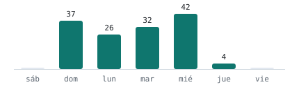

<picture>
  <source media="(prefers-color-scheme: dark)" srcset="assets/banner-dark.svg">
  
</picture>

<!-- status:start -->

🟢 <b>1 contribuciones</b> en los últimos 7 días · 329 en los últimos 30 · actualizado el 27 nov

<!-- status:end -->

Construyo aplicaciones completas: desde el modelo de datos y la API hasta la interfaz, con pruebas y Docker. Últimamente trabajo con **RAG**, **agentes de IA** y **automatizaciones con n8n**. Estudio Ingeniería de Sistemas en la UMG y me formé en desarrollo de software en Campuslands. Busco mi primer rol como desarrollador.

## Proyectos

<table>
  <tr>
    <td width="50%" valign="top">
      <a href="https://github.com/TOTO05-a/roofing-business-platform"><b>roofing-business-platform</b></a> 
      Sitio bilingüe y plataforma interna para una empresa de techos: portal de clientes, empleados y administración. Monorepo con API, app y sitio público. 
      <code>TypeScript</code> <code>React</code> <code>Astro</code> <code>Express</code> <code>PostgreSQL</code>
    </td>
    <td width="50%" valign="top">
      <a href="https://github.com/TOTO05-a/ruta-ia"><b>ruta-ia</b></a> 
      Orientación académica: recomienda cursos de un catálogo real con RAG y muestra las fuentes de cada respuesta. 
      <code>RAG</code> <code>Qdrant</code> <code>n8n</code> <code>PostgreSQL</code> <code>Docker</code>
    </td>
  </tr>
  <tr>
    <td width="50%" valign="top">
      <a href="https://github.com/TOTO05-a/rag-grafo-finetuning"><b>rag-grafo-finetuning</b></a> 
      Convierte documentos en un grafo de conocimiento que se puede explorar y consultar, con cinco estrategias de ajuste y uso de modelos. 
      <code>Node.js</code> <code>MongoDB</code> <code>RAG</code> <code>Grafos</code>
    </td>
    <td width="50%" valign="top">
      <a href="https://github.com/TOTO05-a/applications-api"><b>applications-api</b></a> 
      API de candidatos, vacantes y postulaciones con arquitectura por capas, validación con Zod, errores centralizados y pruebas de integración. 
      <code>Express</code> <code>PostgreSQL</code> <code>Zod</code> <code>Jest</code>
    </td>
  </tr>
</table>

En equipo: fui Scrum Master y desarrollador de <b>FoodieRank</b>, ranking y reseñas de restaurantes (<a href="https://github.com/DulceMR17/proyecto-express-foodierank-backend">backend</a> · <a href="https://github.com/DeniseLH1/proyecto_express_foodierank_frontend">frontend</a>). Más proyectos en mi <a href="https://toto05-a.github.io">portafolio</a>.

## Esta semana

<!-- live:start -->
<picture>
  <source media="(prefers-color-scheme: dark)" srcset="assets/activity-dark.svg">
  
</picture>

**Último commit público:** `feat(empleados): agrega comentario de cabecera en cada archivo` en [prueba-tecnica-acme-antonio-cruz](https://github.com/TOTO05-a/prueba-tecnica-acme-antonio-cruz/commit/72abaeb6160e5962b4c0a5a522ad80ded89a83b9) · 17 nov

**Actualizado hace poco:**
- [prueba-tecnica-acme-antonio-cruz](https://github.com/TOTO05-a/prueba-tecnica-acme-antonio-cruz) · prueba técnica: aplicación de consola en node.js para gestionar empleados con poo, solid y pruebas
- [roofing-business-platform](https://github.com/TOTO05-a/roofing-business-platform) · plataforma web para roofing residencial: sitio bilingüe, crm, presupuestos con pdf, portal de clientes y api con rls en postgresql
- [rag-grafo-finetuning](https://github.com/TOTO05-a/rag-grafo-finetuning) · rag con grafo de conocimiento interactivo y cinco estrategias de ia: transfer learning, sft, few-shot, instruction y domain tuning
<!-- live:end -->

## Stack

También: Qdrant · RAG · n8n · Prisma · Zod · Jest · Vitest · Playwright

## Contacto

[Portafolio](https://toto05-a.github.io) · [LinkedIn](https://www.linkedin.com/in/antonio-cruz-dev) · [anntoniocruz7@gmail.com](mailto:anntoniocruz7@gmail.com)
